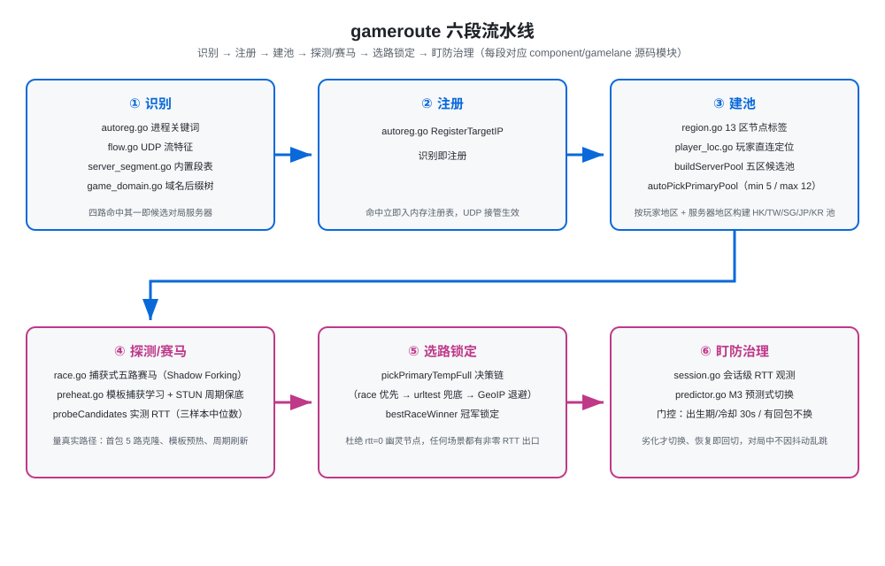

# gameroute — 游戏 UDP 自动识别与最优选路内核（mihomo fork）

**版本**：v0.1.0（2026-10）｜接口文档见 [docs/API.md](docs/API.md)（HTTP API / 配置节 / 运行时数据文件全量）

> 一句话：gameroute 是一个内嵌在 mihomo 内核里的"游戏 UDP 管家"——自动认出哪个 IP 是游戏对局服务器、自动测出当前节点池里哪条链路最快、自动锁住最优出口并持续盯防劣化切换，全程零人工词维护（不用你自己补词表）、零面板操作。

---

## 1. 安装与使用前提（务必先读）

- **必须开启 TUN**：gameroute 依赖 TUN 接管游戏 UDP 流量，**系统代理模式不支持**——TUN 未开启时 gameroute 会保持禁用，并在日志提示 `GameRoute requires TUN mode`（强制项，非可选）。
- **下载二进制**：Windows amd64 已编译版本见 [Release v0.1.0](https://github.com/ppx-ai/gameroute/releases/tag/v0.1.0)（`gameroute-v0.1.0-windows-amd64.exe`）；其他平台请按第 8 节自行构建。
- **配置节（可选，不配即默认关闭）**：在 config.yaml 中按需加入：

  ```yaml
  gameroute:
    enable: true
    targets:
      - process-name: "game.exe"
        proxy: "HK-01"
        fallbacks: ["JP-01", "SG-01"]
  ```

  完整字段（`enable` / `targets[].process-name` / `cidr` / `proxy` / `fallback` / `fallbacks`）见 [docs/config.yaml](docs/config.yaml) 与 [docs/API.md](docs/API.md)。

  > **照抄提示**：`proxy` 留空或写 `auto` 即自动圈选（交给 gameroute 实测选路）；`fallback` 与 `fallbacks` **二选一**，不要同时填——`fallback` 是单备选，`fallbacks` 是备选列表。

## 2. 它解决什么问题

游戏 UDP 流量在普通代理里是最难伺候的一类：

- **识别难**：游戏服务器 IP 遍布全球、动态分配，词表永远补不全；
- **延迟玄学**：代理"选对地区节点"≠"到游戏服快"——机场单入口多出口、落地机绕路时，同名国家节点可能是全机场最慢的；
- **换节点危险**：对局中途换出口轻则掉包、重则被服务端踢出（封号风险）；
- **误杀伤人**：按 IP 段拉黑容易误杀 Steam/Valve 官方核心段，把正常游戏流量挡在门外。

gameroute 的思路：**不猜名字，量真实链路**。

## 3. 工作原理（六段流水线，每段对应源码模块）

```
识别 → 注册 → 建池 → 探测/赛马 → 选路锁定 → 盯防治理
```

| 阶段 | 模块 | 做什么 |
|---|---|---|
| ① 识别 | `autoreg.go` 进程关键词（Unity/虚幻 shipping 变体通杀）<br>`flow.go` UDP 流特征（高频/双向/小包）<br>`server_segment.go` 内置段表（blackmatrix7 + MetaCubeX 规则集，异步拉取+本地缓存）<br>`game_domain.go` 域名后缀树（含 GameLift 7770 测速域 `*.api.aws`） | **免词表四路识别**（内置段表异步拉取、用户无需维护），任何一路命中即候选对局服务器 |
| ② 注册 | `autoreg.go` RegisterTargetIP | **识别即注册**：命中立即入内存注册表，UDP 接管生效 |
| ③ 建池 | `region.go` 13 区节点标签提取<br>`player_loc.go` 玩家直连定位<br>`buildServerPool` / `autoPickPrimaryPool`（min 5 / max 12） | 按玩家地区 + 服务器地区构建五区（HK/TW/SG/JP/KR）候选池 |
| ④ 探测 | `race.go` 捕获式五路赛马（Shadow Forking）<br>`preheat.go` 测速模板捕获学习 + STUN 周期保底<br>`gamelane.go` probeCandidates（URLTest 三样本中位数 + EMA 校正） | 量真实路径 RTT：测速包首包 5 路克隆、模板预热、周期性刷新 |
| ⑤ 选路 | `pickPrimaryTempFull`（race 优先 → urltest 兜底 → GeoIP 兜底退避链）<br>`bestRaceWinner` 冠军锁定 | 任何场景都有非零 RTT 的出口，杜绝"rtt=0 幽灵节点" |
| ⑥ 治理 | `session.go` 会话级 RTT 观测<br>`predictor.go` M3 预测式切换<br>`gamelane.go` 门控（出生期 30s / 切换冷却 30s / 有回包不换 / 坏节点 150ms 触发 + 30min 惩罚） | 质量劣化才切换、恢复即回切；对局中绝不因 RTT 抖动乱跳 |



## 4. 核心设计理念

### 红线（安全边界，写死在代码里）

- **红线 1**：赛马扳机是三路字节级识别——GameLift 测速魔数（payload 前 4 字节 `0xffffffff`，8B≤len<64B，不查端口）/ STUN Binding Request（type `0x0001` + magic cookie `0x2112A442`）/ RakNet Unconnected Ping（`0x01` + 16B 离线消息 ID）；其中 STUN/RakNet 两路受端口守卫（3478/3479/5349/19302 及系统排除端口命中即否决），非测速形态的对局包/普通流量绝不误触发克隆；
- **红线 2**：对局服务器端口（COD 3074 / Valorant 5000-5500 / OW2 26503-36503 闭区间 等）**绝不克隆、绝不预热**——防止节点侧 UDP 会话表风暴、避免游戏服务端拒收（探测包）；
- **红线 3**：预热探针的回包绝不写回 TUN，预热观测不影响真实对局。
- **红线 4**：预热探针用**原样 payload** 构造——任何自定义字段都会破坏服务器原样回显，探针必须逐字节还原客户端发出的测速包；
- **红线 5**：不硬编码任何游戏名或进程名词表——协议级特征（测速魔数 `0xffffffff` / STUN `0x2112A442` / RakNet `0x01`、`api.aws` 域名后缀、Valve 等 IP 段）按公开标准硬编码，但不写死任何单个游戏名。

### 防误杀与自纠错

- `china_ip.go`：大陆 IPv4 路由表（chnroutes 数据，编译期 embed）判定"国内目标 → 直连放行"，替换易缺失/漂移的外部 MMDB；
- `fakecn.go`：反悔接管——漏判为国内又被反查证实是海外对局服的，自动接管；
- `excludelayer.go`：识别前排除层只保留基础设施段；Valve 核心段（155.133.224.0/19 等）从黑名单洗白进白名单（有抓包实锤，非猜测）；
- `ports_exclude.go`：系统服务端口（53/123/443…）外置 JSON 可配置，**不含 3478**（Epic 对局端口就在 3478，排除 = 挡整场对局）；
- `watch.go`：注册不是永久——进程存活不淘汰，进程退出立即清理，动态自我纠错。

### 学习与记忆

- `memory.go`：目标确认注册即写记忆文件，重启后首个包命中记忆直接注册——**"第二次秒识别"**，不重复观察期。

## 5. 可观测性（诊断即产品功能）

- `diag.go`：2048 条事件环形缓冲，关键决策点**同步写入零采样窗口**——卡顿复现后 `/gameroute/diag/dump` 一键导出事件 + 切换历史 + 主出口快照，秒级对齐因果链；
- `miss.go`：未命中明细聚合——"某游戏为什么没被加速"可直接定位到细分原因；
- `metrics.go` / `stats.go`：原子计数器 + M3 切换状态快照。

## 6. 已验证场景（2026-10 实测）

| 游戏 | 场景 | 结果 |
|---|---|---|
| APEX | 有 7770 GameLift 测速模板 | 捕获式赛马选路正常，延迟低 |
| Fortnite（东京服） | 无测速模板 + 对局端口红线 | 从"rtt=0 幽灵出口 189ms 锁死"恢复到港台节点正常水平（网络层 57-70ms） |
| CS2 | 加密流量 | 通用识别 + 兜底链路，延迟正常 |
| Valorant / Warframe | 通用 UDP | 正常 |

## 7. 已知限制（诚实清单）

- **探测对象**：默认探测 Cloudflare/STUN 端点，测的是"节点→公网端点"，与"节点→游戏服"可能不一致（机场单入口多出口、落地绕路时差异明显）。有测速模板的游戏（APEX/GameLift 系）由 7770 捕获式赛马直接量真实链路，不受此限；
- **对局端口不克隆**（红线 2）：无测速模板游戏的真实对局路径只能靠探测间接测量；
- 节点真实链路质量（伪分区、绕路落地）由订阅决定，选路结果受机场质量影响，本模块不创造链路。

### 测速模板：哪些游戏能直接量真实链路

| 类别 | 机制 | 代表 |
|---|---|---|
| **内置识别（首次即有模板）** | 走 AWS GameLift 的游戏：GameLift UDP Ping Beacon（`gamelift-ping.<region>.api.aws`，端口 7770），内核内置识别该测速形态，首次对局命中即直接走捕获式赛马量真实链路 | **APEX**（GameLift 系） |
| **自动学习（第二次对局起有模板）** | 其他任何游戏：只要客户端发过可识别测速包（`0xffffffff` / STUN Binding / RakNet 形态），内核自动为该游戏服务器 IP 学习并持久化测速模板（`runtime/game_probe_templates.json`），之后每次对局自动预热，**无需任何配置** | 所有带可识别测速握手的游戏 |
| **没有模板** | 完全不发可识别测速包的游戏（纯加密 / 无测速握手），同样会被识别、接管并选路，只是选路依据为探测间接测量（而非真实链路实测），效果受"节点→公网端点"与"节点→游戏服"偏差影响 | 纯加密流量类 |

> 也就是说：**"有模板"不需要你手动加**——要么游戏走 GameLift（首次就有），要么玩过一次后内核自动学会（第二次起就有）。真正没有模板的只有"完全不发可识别测速包"的游戏。
>
> **⚠️ 没有模板 ≠ 不能加速**：模板只决定"选路依据能不能用真实链路实测（捕获式赛马）"，**不是加速的门槛**。没有模板的游戏同样会被识别、接管并选路（依据探测间接测量），加速照常生效，只是精度不如有模板时。上面已验证场景里，Fortnite（无模板）、CS2（加密流量）就是活例子。

> **⚠️ 效果边界（务必先读）**
>
> - **本项目只是一个选路器**：它把流量选到"当前节点池里实测最快"的出口，**并不能把坏节点变成好节点**。最终效果由你的节点质量决定——节点质量好，效果就好；节点质量差，谁都救不了。
> - 如果你的节点质量明明很好，却没有选到质量好的节点（例如锁到了慢出口、选错地区节点），请把 `/gameroute/diag/dump` 的日志发过来，我来帮你定位并修复。

## 8. 构建与测试

```bash
# 构建（gvisor 栈；-X 注入版本与构建时间，/version 可查）
# 注意：$(date -u) 是 bash/Git Bash 写法；Windows PowerShell 请改为固定字符串，
# 例如 -X 'github.com/metacubex/mihomo/constant.BuildTime=2026-10-24'
go build -tags "with_gvisor" -trimpath \
  -ldflags "-X 'github.com/metacubex/mihomo/constant.Version=v0.1.0' \
  -X 'github.com/metacubex/mihomo/constant.BuildTime=$(date -u)' -w -s"

# gameroute 模块全量测试
go test -tags with_gvisor -count=1 -vet=off ./component/gamelane/
```

## 9. 源码结构（主要模块）

包内共 25 个非测试源码 + 40 个测试文件（`component/gamelane/`），核心模块：

```
component/gamelane/
  autoreg.go              免词表识别 + 识别即注册
  flow.go                 UDP 流特征识别
  server_segment.go       内置游戏段表
  game_domain.go          域名后缀树（含 7770 测速域）
  race.go                 捕获式五路赛马 + 红线
  preheat.go              模板预热 + STUN 周期保底
  region.go               节点区域标签
  player_loc.go           玩家直连定位
  gamelane.go             主管理器（选路/门控/兜底链）
  session.go / predictor.go  会话观测 + M3 预测式切换
  diag.go / diag_extra.go / miss.go / metrics.go / stats.go  诊断与可观测性
  memory.go / watch.go / process_alive_other.go / process_alive_unix.go / process_alive_windows.go  记忆 + 动态淘汰（进程存活判定按平台分发）
  china_ip.go / fakecn.go / excludelayer.go / ports_exclude.go  大陆路由表/反悔接管/排除层/系统端口表
tunnel/ / hub/route/      内核接管与 REST API 集成点
```

## 10. 常见疑问

### 和手动指定一个节点有什么区别？

手动选节点是"指定一个入口"：你点的是哪个地区、哪个节点，但代理节点的真实链路质量（单入口多出口、落地绕路）你无从知晓——选的"香港节点"可能是全机场到游戏服最慢的；对局中手动换节点还会掉包、甚至被服务端踢出。

gameroute 做的是整条链路的自动管理：

- **不用你猜**：自动识别哪个 IP 是游戏对局服务器（免词表四路识别），识别即接管；
- **不靠感觉**：对候选节点池实测真实链路 RTT（捕获式赛马 / 测速模板），选的是"实测最快"而不是"看起来快"；
- **不用你守**：对局中持续盯防，质量劣化自动切换、恢复自动回切，全程零操作。

一句话：**手动选择是"赌"，gameroute 是"量"**——手动选的是你猜的节点，gameroute 选的是实测最快的链路。

### 和官方 mihomo 内核有什么区别？

官方 mihomo 内核不含游戏对局识别与游戏链路专用选路——官方内核的规则分流、策略组、URLTest/fallback、sniffer、TUN、fake-ip 等基础能力全部保留，但它**不会自动认出游戏对局服务器、不会自动实测游戏链路、也不会对局中自动切换防劣化**。

gameroute = 官方内核 + gameroute 模块：官方内核已有的能力（规则分流、策略组、面板）全部保留，额外增加游戏 UDP 自动识别、实测选路、锁定盯防这套完整的游戏链路管理。官方内核本身的问题不属于本项目范畴，请向上游反馈（见下节）。

## 11. 维护与更新策略（重要）

- **不跟随上游更新**：本项目是基于 mihomo 官方内核的定制 fork，**不随上游官方版本一同更新**——上游发布新版本（包括内核本身）时，本项目**不会**自动同步更新。内核版本、行为与上游官方可能存在差异，请以本仓库发布的内容为准；**上游安全类修复会评估后合**（不盲目跟版，但涉及安全漏洞的修复会评估后合入本项目）。
- **上游问题请找官方**：如果遇到的问题是 **mihomo 官方内核本身**造成的（与本项目的 gameroute 模块无关），请**直接向上游官方反馈**（[MetaCubeX/mihomo](https://github.com/MetaCubeX/mihomo)），不要在本项目提交修复请求——本项目不承担、也无法修复上游内核的问题。

## 12. License

GPL-3.0（继承上游 [mihomo](https://github.com/MetaCubeX/mihomo)）。本 fork 保留上游版权声明，gameroute 模块按 GPL-3.0 发布。

**第三方数据与许可（本 fork 增量部分）**：

- `china_ip.go`：中国大陆 IPv4 路由表来自 [chnroutes2](https://github.com/skkdev/chnroutes2)（Sukka 优化版，CC BY-SA 2.0 + MIT 双许可），署名见 `component/gamelane/data/CHNRoutes-NOTICE.txt`；
- `server_segment.go`：内置游戏段表来自 blackmatrix7 规则集与 MetaCubeX meta-rules-dat（异步拉取 + 本地缓存）；
- `autoreg.go` aux 进程排除词表：取自 [MetaCubeX/rules-mrs](https://github.com/MetaCubeX/rules-mrs)（Apache License 2.0）等仓库，署名见 `component/gamelane/data/AUX-RULES-NOTICE.txt`。

> ⚠️ 仅用于网络链路优化与学习。请遵守游戏服务条款与当地法律法规，不得用于作弊或违规加速。
